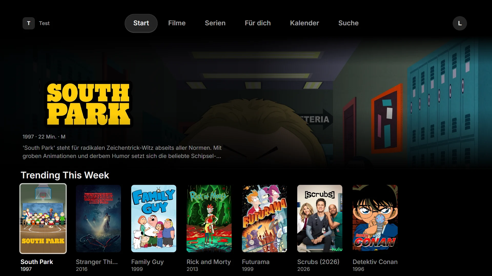
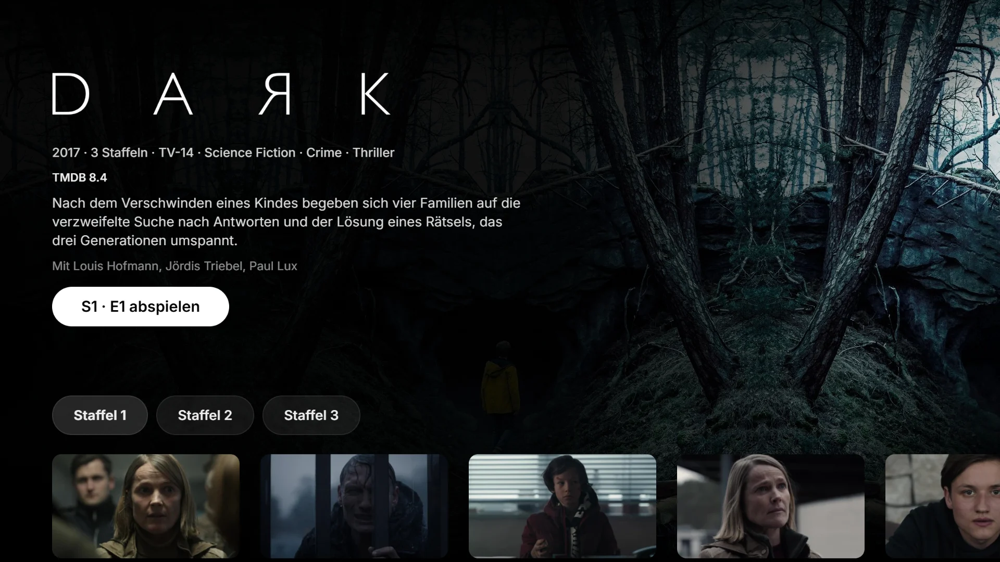
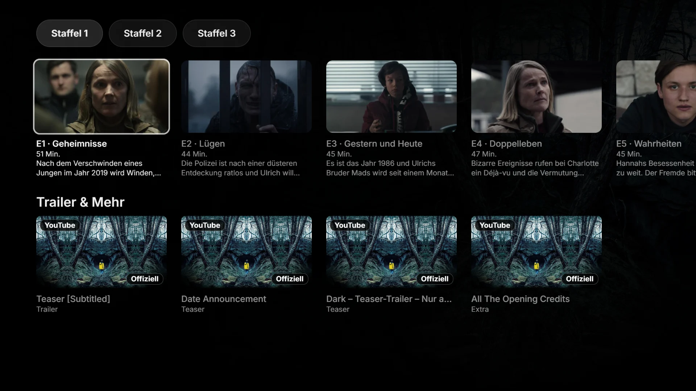
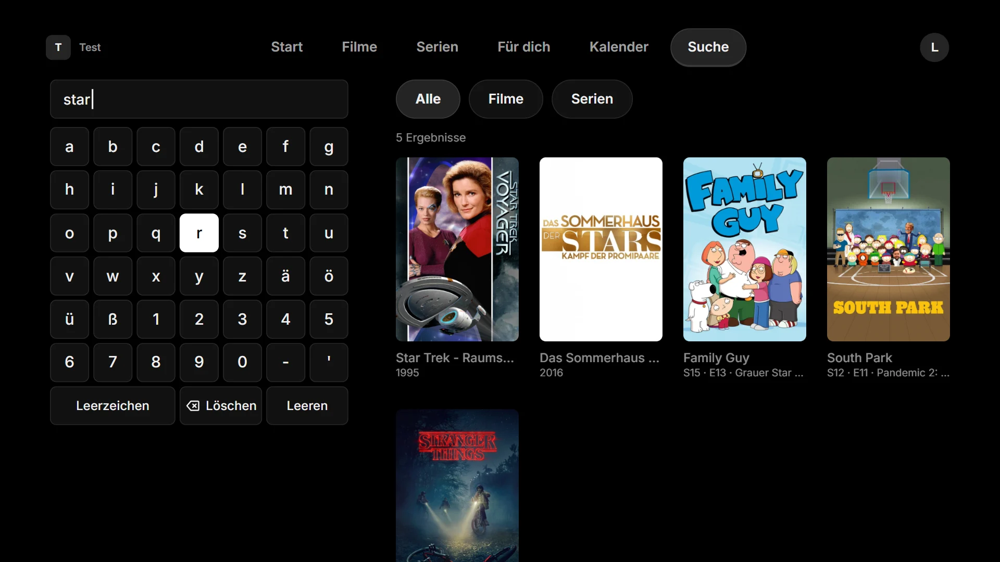
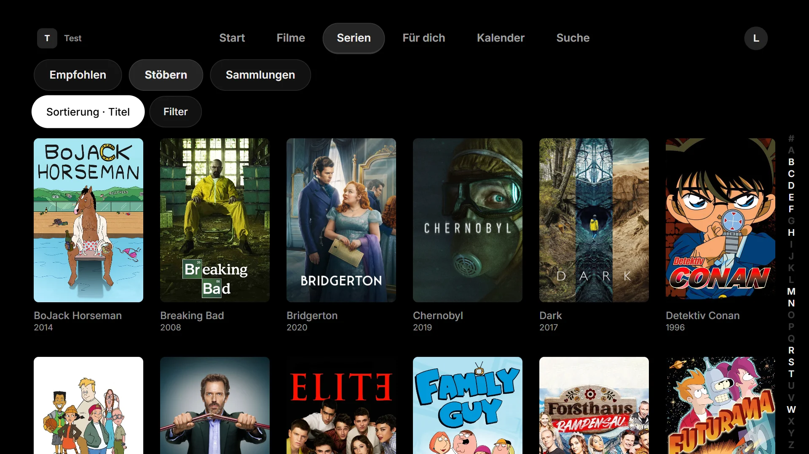

# silo-tv

**A native TV app for [Silo](https://github.com/Silo-Server/silo-server) on LG webOS TVs**, made for the remote control and the couch.

[](LICENSE)


[](https://github.com/Thazzr/silo-tv/actions/workflows/ci.yml)
[](https://thazzr.github.io/silo-tv/mutation/)



> Not an official Silo project. "Silo" is a trademark of Silo Media L.L.C.; this app is an independent client for Silo. `silo-tv` is a working title; the app gets a name of its own before the first store release.

## Screenshots

| | |
|---|---|
|  |  |
| **Detail page**: title art, ratings, seasons | **Episodes** and Trailers & More |
|  |  |
| **Search** with an on-screen keyboard for the remote | **Browse** with sort, filters and a letter rail |

<sub>Taken at 1920×1080 against a test server. Posters, stills and logos belong to their rights holders and are not covered by this project's license.</sub>

## What it does

It works with any Silo server (API v2). You enter the server's address on the TV; nothing is built in.

- **Sign-in from the couch:** a code or QR code you confirm on your phone, or a password with the on-screen keyboard. Several servers, each with its own sign-in.
- **Profiles:** a picker with avatars, PIN-protected and kids profiles, creating a profile, and a choice of how the app picks the profile at launch.
- **Home:** the rows your server's home page is built from (Continue Watching, Next Up, Recently Added and the rest), with a hero.
- **Movies and Series:** recommended rows, collections, and a browse grid with sort, filters (genre, decade, content rating, watch state) and a letter rail.
- **Detail pages:** title art, ratings, quality badges, seasons and episodes, cast, similar titles, box sets, and person pages with filmography.
- **Search** while you type, with box sets, people, movies, series and episodes. The keyboard has ä, ö, ü and ß.
- **Playback** through Silo's playback protocol v3: direct play, and HLS remux and transcode through hls.js. Resume and start over; Continue Watching resumes directly, with an optional rewind on resume.
- **A player in the layout of Silo's web player:**
  - a scrubber with buffer, trickplay previews, chapter marks and coloured intro, recap and credits segments;
  - skips by your profile's steps, scrubbing at up to 16×, skip intro, recap and credits as your profile says;
  - a quality menu (a quality that does not play falls back to the one before), chapters, and an Info panel with what plays now next to the source file;
  - a clock above the scrubber: elapsed and total time with the end time, or just one of them;
  - subtitles drawn by the app in your profile's appearance.
- **Extras:**
  - Trailers & More: local extras play in the app, YouTube trailers open in the TV's YouTube app.
  - Theme music, spoiler protection for unwatched episodes, and AI translation of descriptions, each when your profile and your server turn it on.
- **Made for the remote:** arrow keys, OK and Back everywhere, the Magic Remote pointer and wheel, and focus that comes back to where you were.
- **Your server's look:** its name, logo, sign-in background and accent colour.
- **German and English**, following the TV's language or chosen in the app's settings.
- **Careful with your sign-in:** the short-lived access token stays in memory; only the refresh token is stored on the TV, and HLS streams and subtitles sign in with a header instead of a token in the URL.

Next up in the player: audio and subtitle menus, Up Next, shuffle, subtitle search and subtitle appearance on the TV; then a featured hero on Home and the library tabs. After that come watchlist, For You, calendar, requests and the profile settings. The whole plan is in [`docs/roadmap.md`](docs/roadmap.md), the look in [`docs/design.md`](docs/design.md).

## Status

Early development; there is no release yet.

- Phase 0 (feasibility) and Phase 1 (servers, sign-in, profiles, app shell, TV navigation) run on the test TV.
- Phase 2 (browse) runs on the test TV; a few items are still open (a featured hero, two servers).
- Phase 3 (the player) is in progress. Direct play, HLS, the overlay, skips and the quality menu are checked on the test TV (webOS 26).

The goal is a listing in the LG Content Store. Until then, the app can be installed on a TV in Developer Mode.

**Needs:** an LG TV from 2021 or later (webOS 6 and newer) and a Silo server.

## Try it on your TV

The app is not in the LG Content Store yet. To install it from source:

1. Install LG's **Developer Mode** app on the TV, sign in with an LG developer account and turn Developer Mode on. The Developer Mode session expires unless you extend it in that app.
2. On your computer, install Node.js 24 and PowerShell 7, then run `npm ci` in this repository.
3. Connect the TV once. The passphrase is shown in the Developer Mode app.

   ```bash
   npx ares-setup-device --add tv --info "{'host':'<TV-IP>','port':'9922','username':'prisoner'}"
   ```

   ```bash
   npx ares-novacom --device tv --getkey
   ```

4. Build, package, install and launch:

   ```bash
   npm run tv:deploy
   ```

## Development

Requirements: Node.js 24, PowerShell 7 (`pwsh`), and for the TV an LG TV in Developer Mode.

```bash
npm ci
```

```bash
npx playwright install chromium --only-shell
```

| Command | What it does |
|---|---|
| `npm run dev` | Vite dev server in the browser |
| `npm run build` | production bundle in `dist/` (one classic script for webOS) |
| `npm run check:bundle` | checks `dist/` for webOS compatibility |
| `npm run package` | builds the `.ipk` in `out/` |
| `npm run verify` | the full gate (see [`tools/README.md`](tools/README.md)) |
| `npm run test:coverage` | the unit tests with a coverage report in `reports/coverage/` |
| `npm run test:mutation` | the mutation run with [StrykerJS](https://stryker-mutator.io) (hours for all files; `STRYKER_SHARD=3/24` runs one of the 24 shards the CI uses) |
| `npm run tv:deploy` | build, package, install and launch on the TV named `tv` (`WEBOS_DEVICE` overrides it) |
| `npm run tv:eval` | read the TV probe report (or any expression) from the running app through the webOS Web Inspector |
| `npm run tv:profile` | record a sampling CPU profile of the running app on the TV (`--seconds`, `--interval`, `--out`) into `perf-results/*.cpuprofile` and print the most expensive functions; deploy with `PERF_BUILD=1 npm run tv:deploy` first for readable function names |
| `npm run perf:scroll` | local scroll profiling: unminified build, CPU throttle 6, long tasks, slow frames and renders per key press (not part of the gate) |
| `npm run openapi:update` | refresh the slim Silo API spec from `SILO_SERVER` (no address is stored) |
| `npm run generate:api` | regenerate the typed API client from `openapi/silo-v2.json` |

`tv:deploy` passes launch parameters from the environment:

- `SILO_SERVER` pre-fills the server.
- `PROBE=1` opens the diagnostics probe instead of the app.
- `TRANSPORT=direct|service` chooses how the app talks to Silo (default `direct`).

In the browser the same parameters work as query strings, e.g. `?probe` or `?server=…`.

**In the browser against a real server:** Silo sends no CORS headers, so start `npm run dev` with `SILO_SERVER` set. The dev server then forwards `/api` to that server. In the app, enter the dev server itself (`http://localhost:5173`) as the server address, not the real one.

### Quality checks

Every result below can be checked without trusting a local run:

- **CI** ([`.github/workflows/ci.yml`](.github/workflows/ci.yml)) runs the full gate (`tools/verify.ps1`) on every push and pull request, on GitHub's Ubuntu runners. Each run's summary shows the gate's table, the unit and E2E test counts and the code coverage. The JUnit files, the coverage report and the Playwright report are kept as artifacts for 30 days.
- **Mutation testing** ([`.github/workflows/mutation.yml`](.github/workflows/mutation.yml)) runs StrykerJS over all app code once a week and on demand. Stryker changes the code in small ways (a `<` becomes `<=`, a condition becomes `true`, …) and counts how many of these mutants the tests catch. The files are split into 24 shards that run in parallel and are merged into one report. The report and the score behind the badge are published on [GitHub Pages](https://thazzr.github.io/silo-tv/mutation/). Results are cached, so a weekly run only re-tests code or tests that changed.

### Tech stack

| Area | Choice |
|---|---|
| Language | TypeScript |
| UI | React with Vite, built for Chromium 79 (webOS 6) as one classic script |
| Data | TanStack Query; API client generated from Silo's OpenAPI (`/api/v2`) |
| Playback | the native `<video>` element for direct play, [hls.js](https://github.com/video-dev/hls.js) over Media Source Extensions for HLS; Silo playback protocol v3 |
| Tests | Vitest, React Testing Library, MSW, Playwright |
| TV tooling | `@webos-tools/cli` (`ares-package`, `ares-install`, `ares-launch`, `ares-inspect`) |
| Process tooling | PowerShell (`tools/`), git-cliff for the changelog |

## How it is built

- The app talks only to Silo's native `/api/v2`, not to the Jellyfin compatibility API.
- It is written from scratch against Silo's API documentation and OpenAPI specification. No code is taken from Silo's repositories.
- It is written with heavy AI assistance (Claude Code). One session plans and reviews; a subagent implements each package.
- Every change passes the full gate (types, lint, unit and component tests, the webOS bundle check, Playwright end-to-end tests, packaging). Every phase ends with a test on a real TV.

The house rules are in [`CLAUDE.md`](CLAUDE.md).

## Contributing

Issues, ideas and pull requests are welcome, and reports from webOS versions other than the test TV's are especially useful. Contributions are made under the MPL-2.0. Please sign off your commits (`git commit -s`, the [Developer Certificate of Origin](https://developercertificate.org/)).

## License

[Mozilla Public License 2.0](LICENSE) (`MPL-2.0`). Anyone may use, change and share the app, also through app stores. Whoever shares a modified version must publish the source code of the files they changed under the same license; files of their own may carry another license.

This Source Code Form is subject to the terms of the Mozilla Public License, v. 2.0. If a copy of the MPL was not distributed with this file, You can obtain one at https://mozilla.org/MPL/2.0/.
